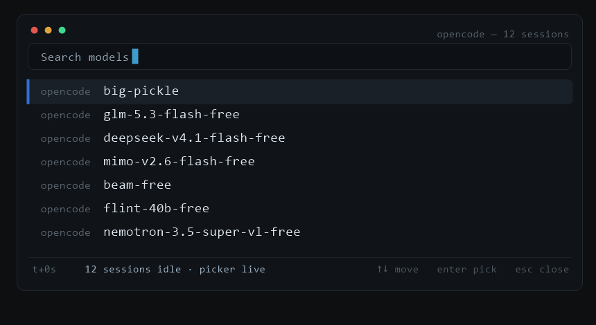

# ● opencode-model-badges

> **Live session badges on every model name — right inside the OpenCode model picker.**

[](LICENSE)
[](https://opencode.ai)
[](https://github.com/engrtarun/opencode-model-badges/releases)
[](https://github.com/engrtarun/opencode-model-badges/actions/workflows/test.yml)
[](package.json)
[](#-how-it-works)
[](#-how-it-works)
[](CONTRIBUTING.md)
[](https://github.com/engrtarun/opencode-model-badges/discussions)

<p align="center">
  
</p>

Do you run 5-7 chat sessions at once and lose track of which model is busy and which is idle? This plugin appends a **live badge** to every model name in the picker:

```
┌─ model picker ────────────────────────────────┐
│  MiMo-V2.6-Flash Free ● [3]   ← 3 sessions    │
│  DeepSeek V4.1 Flash Free ●   ← 1 session     │
│  GLM-5.3 Flash Free ↻         ← rate-limited  │
│  Big Pickle ✕                 ← limit used up │
└───────────────────────────────────────────────┘
```

| Badge | Meaning |
| :---- | :----- |
| *(nothing)* | No session is currently running on that model |
| `●` | Exactly **1** chat session is running |
| `● [N]` | **N (2+)** sessions are running on the same model in parallel |
| `↻` | **Rate-limited** — the model hit a rate/usage limit; OpenCode is retrying with back-off |
| `✕` | **Limit exhausted** — the retry policy gave up; shown until the provider's reset epoch (default 10 min, capped 24 h) |

> **Only currently running sessions are counted — never history.** A model earns a badge only while it is actively working.

**Community:** questions, ideas, show-and-tell → [Discussions](https://github.com/engrtarun/opencode-model-badges/discussions). The v0.4 roadmap vote lives in [discussion #16](https://github.com/engrtarun/opencode-model-badges/discussions/16).

---

## 📦 Install

**Option A — plugins folder (recommended):**

```powershell
# Windows
New-Item -ItemType Directory -Force -Path "$env:USERPROFILE\.config\opencode\plugins\model-badges" | Out-Null
Copy-Item index.ts, lib.ts, package.json "$env:USERPROFILE\.config\opencode\plugins\model-badges\"
```

```bash
# macOS / Linux
mkdir -p ~/.config/opencode/plugins/model-badges
cp index.ts package.json ~/.config/opencode/plugins/model-badges/
```

**Option B — config reference** (add to your `opencode.jsonc`):

```jsonc
{
  "plugin": ["C:/path/to/opencode-model-badges/index.ts"]
}
```

**Reload:** just touch the `LastWriteTime` of `opencode.jsonc` (or restart OpenCode) — the plugin loads instantly:

```powershell
(Get-Item "$env:USERPROFILE\.config\opencode\opencode.jsonc").LastWriteTime = Get-Date
```

**Uninstall:** delete the `plugins\model-badges` folder — done. No config entries, no registry, no background service.

---

## 🚀 Use cases

- **Multi-agent workflows** — 5-7 agents run on different models in parallel; open the picker and instantly see each model's load.
- **Free-model rotation** — a free model got rate-limited? It shows `↻` (retrying) or `✕` (limit used up) — switch to a healthy free one immediately.
- **Stuck session detection** — a session building for 10 minutes keeps its `●` on the same model (tool-call aware).
- **Fair model choice** — when opening a new session, pick a model that is not already overloaded.
- **Live status board** — the model picker doubles as a dashboard; no separate monitoring tool needed.

---

## ⚙️ How it works

```
┌────────────────────────┐   SSE stream (fetch, localhost)   ┌─────────────────────┐
│  OpenCode server       │ ────────────────────────────────▶ │  model-badges plugin │
│  GET /api/event        │   session.status / *.delta /      │                     │
│                        │   session.tool.* / usage.updated  │  runningCount map   │
└────────────────────────┘                                   └──────────┬──────────┘
                                                                         │ ctx.model.transform()
                                                              ┌──────────▼──────────┐
                                                              │  model name + badge  │
                                                              │  "DeepSeek ●"        │
                                                              └─────────────────────┘
```

- **Events:** the server's SSE endpoint (`/api/event`) is read with plain `fetch()` — **no child processes, no terminal flash, no external dependencies**.
- **Liveness logic (four layers, combined):**
  1. **Authoritative** — `session.status` events (`busy` / `retry` / `idle`).
  2. **Activity TTL** — generation-stream events (`.delta`, `session.step.*`, `session.tool.*`, `usage.updated`) keep a badge alive for 15 seconds.
  3. **Tool-call tracking** — during a long build/script the model goes silent; open tool calls are tracked by `toolCallID` so the badge survives (max 10-minute safety cap).
  4. **Rate-limit tracking** — a session whose status is `retry` is blocked, not running: the model earns `↻`. If the retry policy gives up (status drops to idle), the model keeps `✕` until the provider-provided `next` epoch (`retry-after`), capped at 24 h, default window 10 min.
- **Accuracy safety:** stale "idle" and "retry" marks are overridden by fresh activity, deleted sessions have all state cleaned, and a 10-minute safety refresh catches missed events.
- **Model switches:** when an event carries the selected model, its session's badge moves immediately without listing sessions again. Incomplete model events refresh the paginated map after the normal 0.5-second debounce; bulk session updates keep their 8-second debounce.
- **OpenCode v1 + v2 channels:** the same badge contract covers both event vocabularies — v1's `session.status` / `session.idle`, and v2's `session.model.selected` / `session.retry.scheduled` / `session.execution.*` (a model switch moves its badge instantly on both). Durable v2 frames replayed after a reconnect may fix bookkeeping but never paint liveness — no ghost ● on sessions that idled before the connection.
- **Badge hygiene:** names are rebuilt from the bare name every transform (old suffix stripped, new suffix appended) — double badges or stuck badges are impossible.
- **Tuning:** constants at the top of `index.ts` — `ACTIVITY_TTL_MS`, `STATUS_DEBOUNCE_MS`, `TOOL_MAX_MS`, `MIN_MULTI`, `RETRY_MARK_DEFAULT_MS`, `RETRY_MARK_MAX_MS`.

---

## ❓ FAQ

**Q. Why isn't the badge instant?**
Updates are pushed after a ~0.5s debounce. Updating per-token would reload the picker constantly and make it flicker — this is the sweet spot.

**Q. Why plain Unicode glyphs instead of emoji?**
`● ↻ ✕` are text glyphs, not emoji — they render monochrome and identical in every terminal and font (no color-emoji dependency, no Segoe UI surprises on Linux/SSH), and they align cleanly in monospace. Names carrying the legacy `✅` / `✔️ [N]` / `⭐` badges from v0.1.0 are still recognized and cleaned up on the first refresh.

**Q. Does history count?**
No — only *currently running* sessions count. Old sessions never earn a badge.

**Q. How long does the `✕` stay?**
Until the provider-provided reset epoch (from `retry-after`) if the event carried one, capped at 24 hours — otherwise a fixed 10-minute window. Any fresh activity (or a new run) replaces it with the normal badges.

**Q. How do I debug?**
`~/.config/opencode/plugins/model-badges/debug.log` contains `map: running=[...] retry=[...] exhausted=[...]` lines showing the live state.

**Q. Does it work with any provider/model?**
Yes — the plugin only transforms model *names*, so any provider is supported.

---

## 🧯 #2: `fallback` — all-in-one model fallback engine (same repo, second plugin)

Rate/usage limit aaya? This plugin aborts the stuck turn, puts the failed model on a doubling cooldown, and transparently re-sends the work on the next healthy model — your session, context and agent keep flowing. When the original model recovers, the next prompt goes back to it.

```
big-pickle ✕ (limit)  →  auto  →  glm-5.3-flash-free ✅  →  auto  →  back to big-pickle 🔄
```

- **Config:** `~/.config/opencode/fallback.json` — the chain is the full free pool (`big-pickle`, `glm-5.3-flash-free`, `deepseek-v4.1-flash-free`, `mimo-v2.6-flash-free`, `beam-free`, `flint-40b-free`, `nemotron-3.5-super-vl-free`). Delete lines to shrink it. See [`fallback.example.json`](fallback.example.json).
- **Modes:** `cycle` (wrap the chain) / `stop` (toast and give up); transient errors (429/5xx) first let OpenCode's own retry policy take `maxRetries` swings, immediate classes (usage/quota) switch at once.
- **Mid-run failures** send a configurable continue message (the assistant already produced work) instead of replaying the prompt; optional revert keeps history clean.
- **State survives restarts** — cooldowns persist in `~/.local/share/opencode/model-fallback-state.json`; every switch logs via `client.app.log` + `plugins/fallback.log`.
- **Install:** copy both plugins into `~/.config/opencode/plugins/`:

```powershell
Copy-Item index.ts, lib.ts, fallback.ts, package.json "$env:USERPROFILE\.config\opencode\plugins\"
Copy-Item fallback.example.json "$env:USERPROFILE\.config\opencode\fallback.json"
```

- **Upstream watch (no submodules, no Watch needed):** [`upstream.json`](upstream.json) records feature sources + snapshot SHAs of 12 community repos; [`tools/upstream-check.mjs`](tools/upstream-check.mjs) runs daily on cron (`.github/workflows/upstream-check.yml`) and opens a tracking issue here the moment any upstream moves. The engine is an independent implementation — the manifest is traceability, not vendored code.

### Feature provenance (12 repos distilled)

chain cycles · cycle/stop modes · doubling cooldown · persistent cooldown state · toasts (azumag) · immediate vs transient classification · retry thresholds (HyeokjaeLee) · last-user replay · revert of partial turns (peva3) · flow-preserving switch (zaplakhov) · mid-run continue message (renjfk) — deferred ideas (benchmarks, discovery scoring, account balancing, quota tools) tracked as `(deferred)` in `upstream.json`.

---

## 🤝 Contributing

Issues and PRs are welcome! `index.ts` is a single file, so it's easy to read. See [CONTRIBUTING.md](CONTRIBUTING.md) for the workflow. Good-first-issue ideas live on the [Issues page](https://github.com/engrtarun/opencode-model-badges/issues).

## 📄 License

[MIT](LICENSE) © [engrtarun](https://github.com/engrtarun)

---

Made with ❤️ for OpenCode power users. Star ⭐ if it saved you a "which model is busy right now?" moment!
